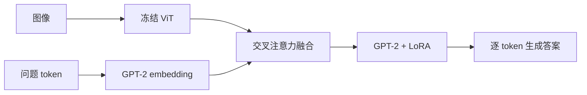

# Multimodal LoRA Lab

**让图像信息进入语言模型，并用受控实验比较融合方式与微调容量。**

课程项目 · PyTorch / Transformers / PEFT · ViT + GPT-2 + LoRA

以病理图像问答 PathVQA 为实验任务，比较普通交叉注意力与门控交叉注意力，并在固定 LoRA 缩放比例的条件下考察 rank。项目展示模型适配、实验设计和结果解释能力。

## 一分钟了解

- **架构**：冻结 ViT-base 图像编码器；GPT-2 使用 LoRA；训练跨模态融合模块。
- **数据**：从 PathVQA 的 validation split 抽取 3,000 条，按固定种子拆分为 2,400 条训练样本和 600 条评估样本。
- **实验**：比较融合结构；对 rank 2 / 4 / 8 / 16 / 32 做消融，保持 alpha / rank = 2。
- **结果**：在同一 200 条评估子集上，rank 2 → 16 时 ROUGE-L 由 0.3632 升至 0.3902；rank 32 回落至 0.3802。
- **判断**：更大的 rank 没有带来单调提升，需要结合参数量和评估证据选择配置。



## LoRA rank 消融


| Rank | 可训练参数（百万） | ROUGE-L | Exact match |
|---|---:|---:|---:|
| 2 | 7.162 | 0.3632 | 0.360 |
| 4 | 7.235 | 0.3760 | 0.375 |
| 8 | 7.383 | 0.3817 | 0.380 |
| 16 | 7.678 | 0.3902 | 0.385 |
| 32 | 8.268 | 0.3802 | 0.370 |

参数量包含融合模块及 LoRA 参数。这里的 ROUGE-L 是文本重合指标，不应表述为“医学准确率”。[完整消融数据](results/rank_ablation.csv)

## 融合方式比较

以下是另一次对 **600 条样本**的保存输出，不能与上面的 200 条子集指标直接比较：

| 配置 | ROUGE-L | Exact match |
|---|---:|---:|
| Cross-Attention | 0.3483 | 0.3433 |
| Gated Cross-Attention | 0.3175 | 0.3150 |
| Gated，学习率 5e-5 | 0.2559 | 0.2550 |

降低学习率没有改善这次运行的结果。门控结构的差异原因仍需额外实验验证。[融合比较数据](results/fusion_comparison.csv)

## 面向产品工作的启发

这个课程原型可以用来说明“选择什么适配方案”的决策过程：先把图文问答拆成编码、融合与生成三个模块，再用可训练参数量、文本指标和生成成本比较配置。现有记录支持 rank 16 在这组候选中取得最高的子集 ROUGE-L；还不足以确定上线配置。

如果继续做成用户可用的产品，下一步应明确具体使用者与任务，补充失败案例分析、独立测试、延迟和成本测量，再判断是否值得部署。当前仓库交付的是实验原型与评估证据。

## 查看与运行

直接阅读 [notebook](notebooks/pathvqa_lora.ipynb)，无需先下载权重。运行建议使用支持 CUDA 的机器；CPU 和 MPS 路径也保留在代码中，但生成评估耗时较长。

```bash
python -m venv .venv
source .venv/bin/activate
pip install -r requirements.txt
jupyter notebook notebooks/pathvqa_lora.ipynb
```

依赖尚无原始版本锁定文件，需在目标环境验证。按顺序运行 notebook，首次执行会从 Hugging Face 下载 PathVQA 数据和模型权重。可先减小样本数、训练轮次与评估数验证流程；改变配置后的结果不能当作上表复现值。仓库不分发原始图像和预训练权重。

## 结果的适用范围

这是课程规模的原型实验，不是官方 PathVQA 测试集评测。训练、调参与评估都来自 validation split 的再划分；当前评估样本同时影响配置选择，正式比较需要额外保留未参与调参的测试集。单个种子且没有置信区间，结果不能支持显著性或临床效能判断。

## 来源与整理

来源为沈依然的 IIDS67692 Part B 作业；课程提供了 PathVQA / GPT / LoRA 实验材料。本仓库保留这一课程背景，不声称提出 ViT、GPT-2、LoRA 或交叉注意力算法。项目展示重点是方案配置、消融实验和效果分析。

本次整理从原 notebook 输出提取 CSV 和图表，清理运行输出及环境元数据，修正与保存输出冲突的讨论，并保留默认 MPS 内存限制。没有重新训练模型，没有重新验证历史指标。
